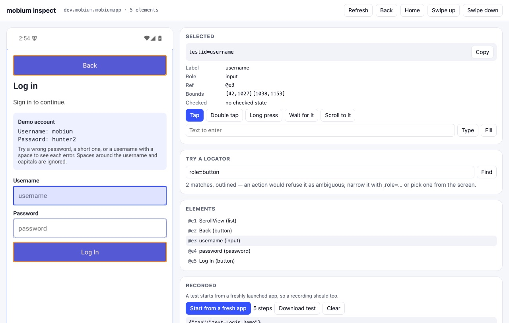

# Quick start: `mobium inspect`

A page on your own machine with the device's screen in it: every element
`map` finds outlined, the locator for the one you click, actions on it, a
place to try a locator and see what it matches — and what you do, kept as a
test `mobium test` runs.

Everything below was run on 2026-09-29 against
[MobiumApp](https://github.com/mobiumdev/mobium-app) on an
Android 15 emulator; the output is what mobium printed. Before this guide:
[the quick start](../quickstart/README.md), and MobiumApp installed.

## Contents

- [1. Start it](#1-start-it)
- [2. Find the locator for anything](#2-find-the-locator-for-anything)
- [3. Try a locator](#3-try-a-locator)
- [4. Record a test](#4-record-a-test)
- [5. Download it as code](#5-download-it-as-code)
- [Who can reach it](#who-can-reach-it)

## 1. Start it

```
$ mobium inspect --device emulator-5554
mobium inspect on http://127.0.0.1:47311/819d02101356fef7563223333156107f/ — Ctrl-C to stop
```

Open that URL — `--open` does it for you. The long part of it is a token: the
page answers nothing that does not carry it ([below](#who-can-reach-it)).
It calls the same tools every command does, through the same daemon, so a
terminal and the page drive one session: run `mobium tap` in a terminal and
**Refresh** shows what it did.

## 2. Find the locator for anything



Click an element on the screen, or in the list under it. The panel says what
`map` says of it — label, role, ref, bounds, checked state — and, at the top,
**the locator a test should use**: the one `map` derived as the most durable
that names it alone, `testid=username` here. The ref, `@e3`, names it on this
screen only.

The buttons under it act on it — tap, double tap, long press, check or
uncheck, wait for it, scroll to it, type or fill text — through the tools,
waiting and refusing as a command would; a refusal is in the log, with its
code. Clicking where no element is offers to tap that point. Back, Home and
the swipes act on the screen.

## 3. Try a locator

Type a locator and **Find**: every match is outlined in orange, and the page
says how many. `role=button` on the Login Demo matches two, Back and Log In —
"2 matches, outlined — an action would refuse it as ambiguous", which is
what `mobium tap role=button` would say, seen before it is said.

## 4. Record a test

A test starts from a freshly launched app, so a recording should too:
**Start from a fresh app** stops the app in front and launches it again, as
`mobium test` does before each test, and starts recording. From there, every
action is a step. Recorded on the Login Demo:

```json
{
  "app": "dev.mobium.mobiumapp",
  "description": "Recorded with mobium inspect.",
  "tests": [
    {
      "name": "recorded",
      "steps": [
        {"tap": "text=Login Demo"},
        {"fill": {"target": "testid=username", "text": "mobium"}},
        {"fill": {"target": "testid=password", "text": "hunter2"}},
        {"tap": "testid=loginBtn"},
        {"wait_for": "text=Welcome"}
      ]
    }
  ]
}
```

(Spaced for reading.) **Download test** saves it as `recorded.test.json`, in
the step shorthand and by locator. It runs as it is:

```
$ mobium test recorded.test.json
  ok    [default · emulator-5554] recorded.test.json › recorded (8.5s)
1 passed (8.5s)
```

Since 2026-10-12 a recording quotes each locator — `testid="username"`,
`text="Welcome"` — because `map` derives every one as the whole value and
checks that it names one element so; the run above predates that, and an
unquoted `text=Welcome` is met by "Welcome back" too. A page element with
no id or test id is recorded by its whole text, narrowed by its role where
the text names several: example.com's link records as `text="Learn more"`.
Only a page element nothing names alone, not even with its role, is recorded
by its ref, which names it on that screen only — replace it before running
the test.

A recording keeps what you typed, the password included; that is the demo
account's here, and worth remembering before recording against your own.

**An element with no locator of its own is recorded scoped to it.** `map`
names one of several look-alikes — every row's More — by its ref or its
path, and both are this screen's only: a ref lasts one map, and a path moves
whenever the list adds or reuses a row. So before the action, the recorder
tries what a person writing the test would: the element's name `within` the
nearest element that has a locator, or within a text on the screen — a
row's title is no target, so `map` does not list it — and then its place
among the look-alikes, `,nth=`. Each is checked against the screen with
`find`, and kept only if it names that element and nothing else. On the
Table Demo, Item 2's More, which `map` lists as `path=0/0/0/0/0/0/4/0/8`:

```
tapped path=0/0/0/0/0/0/4/0/8 at (740, 804) — recorded as label="More",role=button within text="Item 2"
```

**Expect, as it is now.** Under the text box, three buttons record an
assertion: the element's text (the box's text, or its label), its value
(for a field or a slider) and its checked state. Each is a `wait_for` that
runs at once, and is recorded only if it holds, so a recorded expectation
is one the screen met.

**`--record <file>`** writes the recording after every step, for a person
recording into an editor: a `.test.json`, or a program by its extension —
`.py`, `.mjs`, `.go`, `.java` or `.cs`. It is the same file the download
gives.

## 5. Download it as code

Next to **Download**, pick the language: the test file, or a program in
Python, JavaScript, Go, Java or .NET. Every step is one tool call and every
client has every tool, so the program is the same steps through the
client's own methods, starting from the app launched fresh. The Table Demo
recording above, as Python:

```python
# Recorded with mobium inspect.
from mobium import start

with start() as device:
    device.terminate("dev.mobium.mobiumapp")
    device.launch("dev.mobium.mobiumapp")
    device.scroll_to("text=\"Table Demo\"")
    device.tap("text=\"Table Demo\"")
    device.tap("label=\"More\",role=button within text=\"Item 2\"")
    device.wait_for("testid=\"tableOutcome\"", condition="text", text="More: Item 2", exact=True)
```

The program names no device; `start()` takes the only one running, and
`start(device=...)` names one. A step the table cannot write exactly — a
two-finger tap, a wait for a count — is refused when you download, naming
the step, rather than written as a different one: download the test file
for that recording. [`docs/checks/codegen.sh`](../checks/codegen.sh)
records this flow, downloads it in all five languages and runs each on the
device; it passed on the Android 15 emulator and the iPhone 17 Pro
simulator on 2026-10-22.

## Who can reach it

It listens on 127.0.0.1 only, so nothing off this machine can. That is not
enough for a page that taps a device: any web page open in the same browser
can send a request to 127.0.0.1. So the inspector answers only a request
that carries the token from the URL it printed — which nothing else has —
and whose `Host` is the address it listens on, which a DNS-rebinding page's
is not. An action must be a POST, and must be one of the actions above:
the page cannot uninstall an app or run a script in a WebView by naming
the tool. On a real phone the screen is somebody's; the page shows it only to
the person who started the command, and saves nothing but the test they
download.
